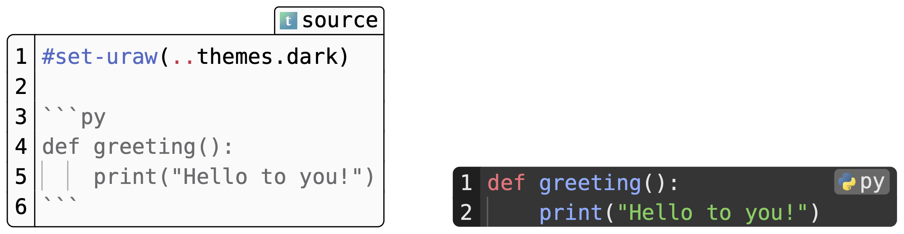
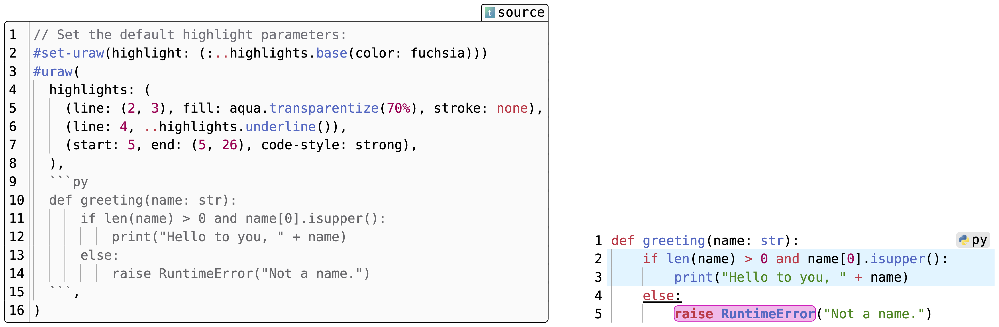
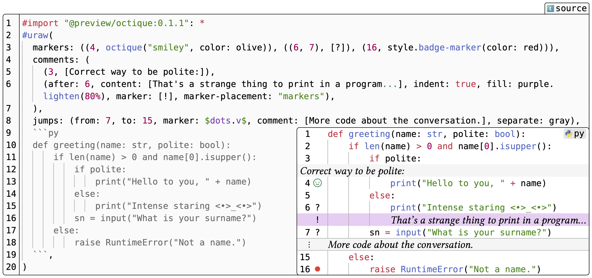
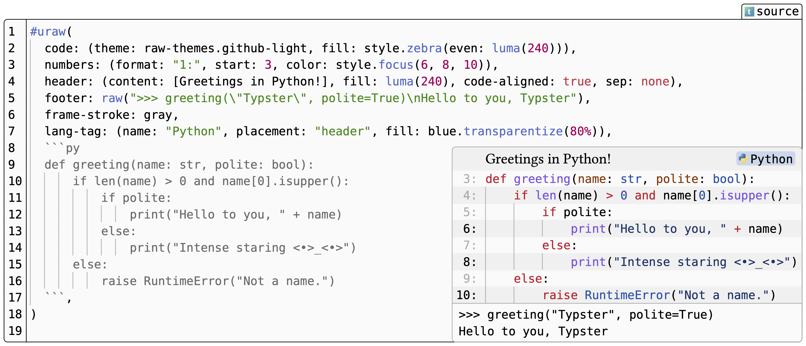
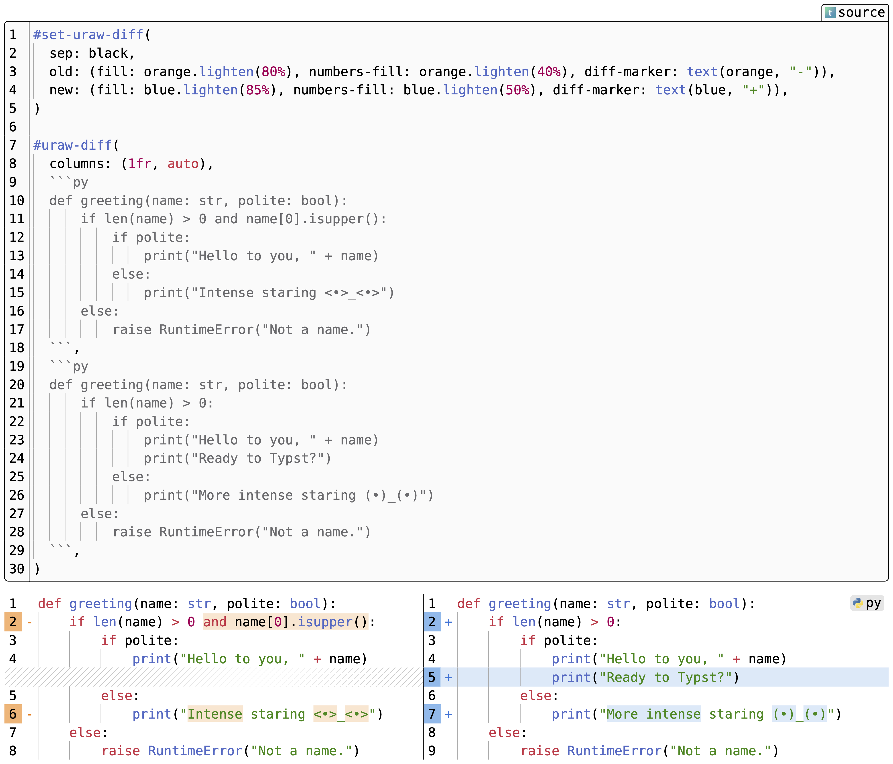
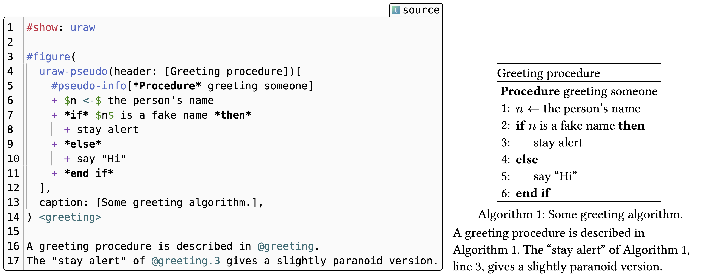

# ultraw

**`ultraw`** is a Typst package that let's you customize raw text. It provides many features like highlighting some code, adding markers and comments, jumping over lines, a dark and other themes, presenting diffs and writing pseudo code.

## Overview

## Starting

The main function of the **`ultraw`** package is `uraw`. It can be used as a show rule for the whole document to format all raw blocks or per raw block to have precise settings, markers, comments, highlights, etc. The two following examples produce the same results:

The `set-uraw` function enables changing the settings of `uraw` globally, for example to change the theme:

**`ultraw`** provides a lightweight, quick and robust way to highlight raw text by typing highlights delimiters right inside the raw block:

By default only the base (`*:...:*`) and alert (`*!...!*`) highlights are available. Other highlights are provided and can be added using the `highlights` module. Highlights can also be defined locally when using the `uraw` function:

Markers (lying in the numbers column), comments (between lines of code) and jumps (skiping numbers and possibly raw text lines) are available. Here is a complete example showing them:

More styling is available for a complete look customization:

Diffs are defined with the `uraw-diff` function that automatically produces the diff between two codes. By default it has the same theme as `uraw` and support more styling options (settable via `set-uraw-diff`). Here is an example:

Writing pseudo code is also possible with **`ultraw`** with the `uraw-pseudo` function. It enables defining pseudo code as ordered lists (with `+`):

Lines of `uraw`, `uraw-diff` and `uraw-pseudo` outputs inside labeled figures can be referenced **if** `#show: uraw` is used.

## Documentation

Look at the complete [Documentation](https://github.com/JulesViennotFranca/ultraw/blob/main/docs/doc.pdf) for more cool features.
